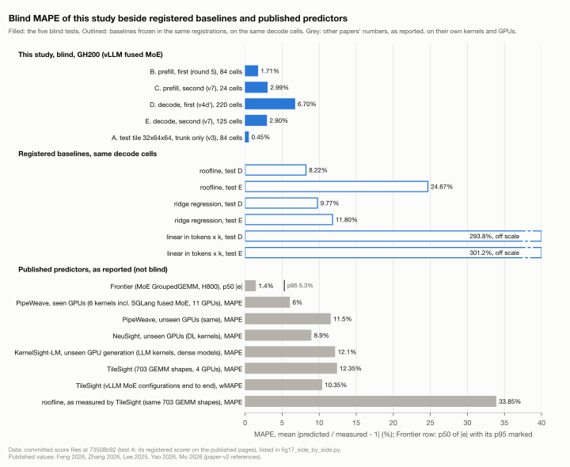

# Predicting vLLM's fused MoE kernel time before it runs: a pre-registered blind evaluation on GH200

Draft v2, 2026-11-19; sections 8 and 9 added 2026-11-21. Reframed from `paper.md` (the full study record, unchanged). Sections 3 to 5's numbers are recomputed from the
committed per-cell score files at 73508b92 by `docs/paper-v2/figures/fig17_side_by_side.py`, which checks every printed
value in Tables 3 to 5 (test A's committed score file holds pooled statistics only, so its per-cell errors are rebuilt
by its registered scorer on the published pages). Section 6 (2026-11-20) is from the serving run's score report,
`vm/results/prod-main-20261120T035826Z/score/prod.score.txt` (with `score/qwen3/` and `score/lc1410/`), scored by
`scripts/prod/offline.sh` at fe96486c from the per-call data on branch `run-gh200-prodmain-20261120t0349` (cb3c555e);
the score files are committed on that branch at baf26ad7. Section 7 (2026-11-20) is from the blind run's score
reports, `vm/results/prod-<model>-<stamp>/score/prod.score.json` on branches
`run-gh200-blind-ling-mini-2.0-20261120t175642z` and `run-gh200-blind-glm-4-7-flash-trinity-mini-20261120t195848z`,
scored on each board at dc8b3f73. Sections 8 and 9 (2026-11-21) are from the v10 blind run's score reports,
`vm/results/prod-<model>-20261121T073522Z/score/prod.score.json` on branch
`run-gh200-blind-granite-4-0-h-small-20261121t073522z` (08c6087), scored on the board at f1a0c0c4; Table 18 is from
`docs/paper-v2/split/split10/split.py` on that branch's per-call data.

## Abstract

We predict the run time of vLLM's Triton `fused_moe_kernel`, the expert-FFN forward pass of a mixture-of-experts
layer in inference serving (training is not studied), from the layer shape and the per-expert token counts, before the kernel runs. The model prices every thread
block (CTA) the kernel launches, in the kernel's own launch order. It decides which CTA fetches each expert weight slab
from DRAM and which finds it in L2. It then times each CTA as a soft maximum of its compute floor and its DRAM
stream. On the tiles vLLM selects, measured terms replace the parts of this base model that do not hold: prefill-specific
byte laws, clock sag and an L2 re-read rule on prefill tiles, and a per-CTA life law on decode tiles. Every cell test in this paper is blind. The predictions for each test were
committed to a public repository before the GPU that measured them was launched, on models (or model shardings) the
model had never been timed on. On an NVIDIA GH200 at a locked clock, on the tiles vLLM selects in serving, mean absolute
percentage error (MAPE) is 1.71% and 2.99% on prefill (84 and 24 cells) and 2.90% on decode (125 cells, T 1 to 128
tokens); on a fixed test tile used as a controlled check, 0.45%. A registered roofline baseline on the same decode cells reads 24.67%, and a
registered regression baseline reads 11.80%. Published GPU kernel-time predictors report 6.0% to 12.35% MAPE over
broader kernel and GPU sets, none with predictions registered before measurement. In vLLM serving on two models
the model had never been fit on (ERNIE-4.5-21B-A3B and Qwen3-30B-A3B, real weights and routing, every MoE call
scored; not pre-registered), the model reads 1.27% and 2.61% MAPE on decode calls and 2.89% and 8.23% on prefill calls, beside Frontier's
operator predictor profiled and trained per model on the same board (3.48% to 5.19% on decode, 1.32% to 13.10% on
prefill, by feature set) and a roofline (15.0% to 26.7%; 85.8% on long prompts, where the model reads 0.62%). Most of the model's prefill error there is a fixed over-prediction, which we
trace to an intercept fitted on Mixtral-8x7B. Two frozen revisions replace it with the measured cost of the call's
non-GEMM kernels, one prefill tile each (v9, v10), and each is scored in serving on three models captured after it
was frozen. The final model, v10, keeps v8's decode, which reads 1.27% to 4.04% MAPE over all eight serving models,
against 2.16% to 6.68% for Frontier's lowest arm on each and 12.6% to 36.0% for the roofline. Its prefill is scored
only on its own blind models (LFM2-8B-A1B, Phi-mini-MoE, granite-4.0-h-small): 5.46% to 6.73%, against 1.07% to 2.84%
for Frontier with its simulator's features, 3.57% to 10.44% with its CLI features, and 22.4% to 43.8% for the
roofline. On those three models removing the intercept leaves every changed tile under-predicted, and v8, frozen
beside v10, reads lower than v10 on two of them. We report these numbers side by side with their scopes and leave
the comparison to the reader. All predictions, pages, scorers and model code are public.

## 1. Introduction

A mixture-of-experts (MoE) layer sends each token to k of E experts, so each expert's FFN runs a GEMM over a
different number of rows. vLLM sorts the tokens by expert, pads each expert to whole M-tiles, and launches one Triton
kernel per GEMM (w1, the fused gate and up projection, then w2, the down projection). How long that call takes depends
on the token counts, the tile, the order in which the CTAs launch (set by `GROUP_SIZE_M`), and what the 60 MiB L2 keeps
between CTAs that read the same weight slab. Serving schedulers, autotuners and capacity planners all want this number
before they run the kernel.

Performance models for GPU kernels are usually evaluated retrospectively. The authors collect measurements, split
them into training and held-out sets, and report the held-out error. That protocol leaves room for an effect that is
easy to miss from the inside: every model revision chosen while the held-out numbers are visible leaks a little of the
test set into the model. We saw it in our own work. On vLLM's prefill tiles, four offline model rounds were each
declared with the earlier rounds' held-out numbers in view, and the selected law won its last tie-break by 0.03 points
of pooled rms. A held-out split cannot remove that risk. A prediction committed before the measurement exists can.

So every number in section 5 is a blind prediction. For each test, the frozen model code, its constants
and the per-cell predictions were committed to a public GitHub repository, and the cloud GPU that measured them fetched
that commit before it took its first measurement. Scorers were written and tested on synthetic pages before any real
page existed. The repository records the order of every step in git.

**Contributions.**

1. A CTA-level timing model for vLLM's fused MoE kernel, written out in full (section 4): a per-CTA walk in
   launch order, with measured replacements for vLLM's prefill and decode tiles.
2. Blind accuracy on five tests over 10 model configurations, 537 cells, reported in the same metrics the published
   predictors use (MAPE), beside registered roofline and regression baselines on the same cells (section 5).
3. A side-by-side reading against published GPU kernel-time predictors, with the scope of each (section 5.1).
4. Measurements of the kernel's behaviour on GH200 that the model needed: per-CTA slab rates against GPU-wide load,
   the slowest-CTA factor, the per-CTA fixed cost, and an L2 re-read rule (section 10).
5. A production check in vLLM serving on two models, every MoE call scored against its traced kernel time,
   beside Frontier's operator predictor and a roofline, with the run-to-run floor and counted DRAM bytes (section 6).
6. The cause of the model's largest serving error, a fitted intercept, and a revision (v9) that replaces it with
   measured kernel costs, scored blind in serving on three new models beside v8, Frontier and a roofline, with
   step-level intervals (section 7).
7. The same change on the other prefill tile (v10), scored blind in serving on three more models beside v8, v9,
   Frontier and a roofline, with a per-kernel split of where the remaining error sits (section 8), and the final
   model's results by regime (section 9).
8. The protocol and every artifact: registrations, frozen code, pages, scorers and rescore commands (section 12).

## 2. Background

### 2.1 The kernel and the card

vLLM 0.27.1's `fused_moe_kernel` is one Triton kernel launched once per GEMM. Its grid has one CTA per (M-tile,
N-tile) pair. CTAs map to tiles through `GROUP_SIZE_M` (G): with G 1 the N-tile index runs fastest, so consecutive
CTAs read different weight slabs of the same expert; with larger G, groups of M-tiles share each slab before moving on.
Whether a slab is still in L2 when the next CTA needs it is the main source of variation the model has to capture.

vLLM picks the tile from the token count. For the models here, prefill uses 128x128x64 or 64x128x64 tiles (8 warps,
3 stages, wgmma). Decode uses 16x64x128 (4 warps, 4 stages) and three 4-warp, 3-stage tiles. The study also uses one
fixed test tile, 32x64x64 with 8 warps and 4 stages, which vLLM does not pick for these models. It is the tile the
trunk model was built on.

The card is an NVIDIA GH200 480GB (132 SMs, 60 MiB L2, HBM3) on Lambda Cloud, one board per session, at the default
700 W power limit. The SM clock is locked at 1710 MHz for the test tile and decode, and at 1410 MHz for the prefill
tiles, where 1710 MHz does not hold under the power limit.

### 2.2 Prior work

**Table 1. Published GPU kernel-time predictors that include MoE workloads or GEMM tiling.**

| work | what it predicts | reported error | predictions registered before measurement |
|---|---|---|---|
| PipeWeave (Zhang et al., ISCA 2026) | kernel time from analytical pipeline features plus an MLP; six kernels incl. SGLang's fused MoE Triton kernel, 11 GPUs | 6.0% MAPE on seen GPUs, 11.5% on unseen GPUs (all kernels; no MoE-only figure) | no |
| NeuSight (Lee et al., ASPLOS 2025) | DL kernel latency from tile-level predictions bounded by roofline laws | 8.9% MAPE on GPUs not used in training | no |
| TileSight (Mo et al., 2026) | GEMM time from a tile-order reuse-distance L2 model, no training | 10.35% wMAPE on vLLM MoE configurations end to end; 12.35% MAPE on 703 CUTLASS GEMM shapes, 4 GPUs | no |
| RaMP (Sharma and Datta, 2026) | when GROUP_M swizzling pays, for its own FP8 MoE kernel on H200 | 0.91% configuration regret (not a time error) | no |
| Hoque et al. (PyTorch blog, 2024) | L2 hit rate of a column-major launch order in vLLM's MoE kernel, H100 | no predictive model | no |

TileSight's idea that tile order sets L2 reuse is close to our trunk. PipeWeave is the only predictor we found that
trains on a fused MoE kernel. None of the works above registers predictions before measuring, and our searches
(listed in the References note) found no GPU kernel performance-prediction study that did.

## 3. Method

### 3.1 Blind protocol

Each test follows the same order.

1. **Freeze.** The model code and its constants are frozen by sha256.
2. **Predict.** The per-cell predictions are computed from the frozen model and written to a registration file, with
   the cells, the measurement plan and the scorer. Scorers are tested on synthetic pages only.
3. **Publish.** The registration is committed and pushed to GitHub.
4. **Measure.** A cloud GH200 is launched. It fetches the run commit from GitHub and refuses to run if the fetched
   source does not hold that commit. It measures, then pushes its pages to the repository.
5. **Score.** The registered scorer runs once on the pages, from a clean checkout. Its output is committed, and
   `rescore.py` reproduces it from the published pages.

The model is never changed between steps 1 and 5. Nothing in this paper's results tables was refitted after its pages
were read.

### 3.2 What "unseen" means in each test

A cell is a (model configuration, token count, routing) triple; a model configuration is a model at one tensor-parallel
sharding. "Unseen" is narrower than "new to the study", and Table 2 states it per test.

**Table 2. The five blind tests.**

| test | tile | model version | cells | model configurations | what was new to the model |
|---|---|---|---:|---|---|
| B. prefill, first | 128x128x64 and 64x128x64, G 1 and 16 | round 5 | 84 | Phi-3.5-MoE, Qwen1.5-MoE-A2.7B, JetMoE-8B, DeepSeek-V2-Lite | the models on these tiles; DeepSeek-V2-Lite's shapes were seen |
| C. prefill, second | 128x128x64, G 1 and 16 | v7 | 24 | Granite-3.0-1B-A400M, Granite-3.0-3B-A800M, Qwen2-57B-A14B at tp8 | the models on these tiles; Qwen2-57B was a calibration model at tp1 |
| D. decode, first | four decode tiles, T 1 to 128 | v4d' | 220 | DeepSeek-V2-Lite, Qwen1.5-MoE-A2.7B, Phi-3.5-MoE, Granite-3.0-3B-A800M, JetMoE-8B | the models at decode (calibrated on OLMoE and Mixtral-8x7B) |
| E. decode, second | four decode tiles, T 1 to 128 | v7 | 125 | Mixtral-8x22B, Qwen2-57B-A14B, Granite-3.0-1B-A400M | the models at decode |
| A. test tile | 32x64x64, G 8 | v3 | 84 | Mixtral-8x7B, Phi-3.5-MoE | the skewed routing (48 cells); 36 cells are uniform replicates; constants fitted on Mixtral-8x7B |

Prefill calibration used OLMoE, Qwen2-57B, Mixtral-8x7B, Mixtral-8x22B and Mixtral-8x7B at tp2. Tests D and E were
each preceded by a calibration measurement on the same board (test D) or a different board (test E).

### 3.3 Measurement

Each page times vLLM's own kernel on synthetic weights with the target model's shapes. Routing is synthetic: uniform
counts, or skewed histograms fitted to summary statistics of three public routing logs. No timing is kept for a cell
whose output fails an fp32 reference in the same run. Prefill and test-tile pages time one call at a time; decode pages
time a CUDA graph of back-to-back calls on rotating weight copies, so each call reads its weights from DRAM as it would
in serving.

Each page is checked before it is scored: the clock lock must hold on every repeat, a token-order equivalence test
checks that permuting tokens within an expert does not change the time, and the decode pages confirm that the kernel
received vLLM's default config. Cells whose GPU time is too short to separate from host launch overhead (under
0.40 ms in test C) are dropped by a registered rule. That rule removed 30 of test C's 54 cells, all at the smallest
token counts.

### 3.4 Metrics

For each cell, e = predicted / measured - 1. We report MAPE (mean |e|), rms of e, mean e (the bias), the worst |e|, and
the share of cells within 5% and 10%. Decode cells whose absolute error is at most 1 µs are counted as e = 0, as the
registered scorer does. MAPE is the statistic most published predictors report, so it leads the comparison.

## 4. The model

The model is one function, `price(cell)` (`scripts/r3_timing_model_v7.py`), that dispatches on the tile. It is a
declared switch over three regimes, not one law shown to hold across them. All three start from the same per-CTA walk
(4.1). On vLLM's prefill tiles four of the trunk's terms are replaced (4.2); on its decode tiles the GEMM time itself is
replaced (4.3). Every constant below was fitted or measured on calibration pages; none was fitted on a test cell.

### 4.1 The trunk: price every CTA in launch order

For each GEMM g in {w1, w2} the trunk walks the grid in vLLM's pid order.

1. **Launch order.** For pid in [0, R x npn), with R grid rows and npn N-tiles per row:

   ```
   gid    = pid // (G * npn)
   first  = G * gid
   size   = min(R - first, G)
   pid_m  = first + (pid mod (G * npn)) mod size
   pid_n  = (pid mod (G * npn)) // size
   ```

   Rows past the live tokens are dead CTAs; they exit early and are priced separately (step 5).

2. **Who fetches.** A CTA fetches its weight slab from DRAM (L_i = 1) if it is the first live CTA of its group to
   touch that (expert, N-tile) slab; the others in the group find it in L2.

3. **Bytes per CTA.**

   ```
   r_i = L_i * s_g  +  a_g * (rows_i / BLOCK_M) / npn_g     s_g = BLOCK_N * K * 2 B   (weight slab)
                                                             a_g = BLOCK_M * K * 2 B   (activation rows)
   b_i = sigma_g * r_i  +  o                                 o   = output tile bytes
   ```

   rows_i / BLOCK_M scales a partly filled M-tile's activation share. sigma_g scales the walk's bytes to the byte
   model's predicted DRAM reads for the GEMM; the byte model is fitted on counter pages of calibration models.

4. **Time per CTA.** Each CTA waits on its compute floor or its share of DRAM bandwidth; the model takes a soft
   maximum of the two:

   ```
   t_i = ( F_i^p + M_i^p )^(1/p),     p = 14

   F_i = q_g * S'_g * c / SMs          compute floor
   M_i = b̄_i / bw                      DRAM time
   ```

   S'_g is the CTA's k-steps plus a fixed per-CTA cost (Phi_w1 1.512 and Phi_w2 2.846 k-steps), c is time per k-step,
   q_g = ceil(N/SMs) / (N/SMs) charges the last wave's idle SMs, and b̄_i is b averaged over a window of
   floor(k_w x SMs x occupancy) CTAs around i (k_w = 0.5), the CTAs in flight with it. A grid under two waves prices its
   last partial wave of k CTAs at no less than

   ```
   max( ceil(k / SMs) * S'_g * c ,  (sigma_g * sum r + o * k) / min(bw, rho * k) ),    rho = 11.48 GB/s per CTA
   ```

5. **The call.**

   ```
   T = T0  +  sum_g [ sum_i t_i  +  max(0, dead_g * 0.995 ns - 0.325 * occ * S'_g * c) ]  +  B_other / bw  +  s_path
   ```

   B_other is the bytes of the call's two small kernels (`silu_and_mul`, `moe_sum`). s_path is a fixed offset for
   vLLM's small-batch (s_small) or block-scan (s_block) align path.

**Constants.** Five are fitted per card on calibration pages (Mixtral-8x7B, the CAL fit every later test uses):
T0 0.0432 ms, c 202.55 ns per k-step (346.4 cycles at 1710 MHz), bw 3597.8 GB/s, s_small +13.0 µs, s_block -7.1 µs.
Seven study constants were fitted on counter or timed pages: p 14, k_w 0.5, Phi_w1 1.512, Phi_w2 2.846, the dead-CTA
cost 0.995 ns and its overlap factor 0.325, and rho 11.48 GB/s. At the test tile the model is the trunk exactly (v3).

### 4.2 Prefill tiles (128x128x64 and 64x128x64)

The prefill branch keeps the walk and replaces four of the trunk's terms. All four were fitted on prefill calibration
pages before test B (the frozen "round 5"); the fifth item, the re-read term, was added for test C.

**(a) Byte laws.** w1 and w2 bytes come from prefill-specific byte laws (staggered-cut for w1, W2 for w2), which set
sigma_g.

**(b) The compute floor at the prefill clock.** c is carried to the 1410 MHz lock (c x 1710/1410), and the floor uses
the wgmma k-step cost measured on these tiles.

**(c) A softer maximum against the triad rate (128x128 only).**

```
t_i = ( F_i^6 + M_i^6 )^(1/6),     M_i = b̄_i * (S + 2.75) / (S * 3726.2 GB/s)
```

S is the GEMM's k-steps; 3726.2 GB/s is the measured triad rate, not the fitted bw. 64x128x64 has no such term: it
keeps the trunk form with p = 3.75 at bw 3597.8 GB/s. The co-residency rate rho is doubled on both tiles.

**(d) Clock sag.** Under the 700 W limit the SM clock dips at kernel start (section 10.6). Per GEMM, with t0 its
sag-free time, the k-step time is multiplied by

```
fac_g = 1 + [ A (1 - e^(-t0 / tau)) - 6.11 µs (1 - e^(-t0 / 50 µs)) ] / t0
```

so the sag enters every CTA's compute floor inside the soft maximum. (A, tau) is measured on the target board from two
timed pages before its cells are predicted, for example (59.815 µs, 612.5 µs) on test B's board; a GEMM much shorter
than tau loses about A x t0 / tau, not A. 64x128x64 has its own pair.

**(e) Which w1 re-reads miss L2 (G 1 only; test C).** At G 1 the N-tile index runs fastest, so M-tile j + 1 of an
expert reads the w1 slab M-tile j read exactly P pids earlier (P = ceil(2I / 128)). Whether that re-read hits L2
depends on how many bytes the whole GPU streamed between the two reads:

```
Bytes_w1 = C_u + m̂ * R

C_u = (experts with at least one token) * W_e  +  (unique tokens) * H * 2     each slab and each A row once
R   = sum_e (m_e - 1) * W_e,   m_e = ceil(c_e / BLOCK_M)                       the re-read demand
m̂   = share of re-read pairs (r, r - P) with distance d > 47.5 MiB             the L2 miss fraction
d   = ((s_r + l_r / 2) - (s_{r-P} + l_{r-P} / 2)) * W_c * slab                 bytes streamed between mid-lives
```

Starts s and lives l come from a launch layer that places CTAs in pid order onto W_c slots (264 at 128x128, 396 at
64x128), each life max(0.05, 1 + sigma x eps) median lives, sigma 0.08 (128x128) or 0.06 (64x128); m̂ is the mean of
6 seeded replicas, and slab = 128 x K x 2. Bytes_w1 enters through sigma_w1, so the walk still sets each CTA's share.

### 4.3 Decode tiles (16x64x128, 32x64x128, 32x128x64, 64x128x64, all 4 warps)

Decode GEMMs launch few CTAs, often under one wave, each streaming a short slab. The trunk's shared-bandwidth step
does not hold there: a CTA's slab rate depends on how many other CTAs are streaming at once (section 10.1). The decode
branch keeps the walk (it gives n live CTAs and the slab), the per-CTA floor S' c, the dead-CTA term and T0 (refitted
on decode calibration pages, Mixtral-8x7B and OLMoE), and replaces each GEMM's time with a per-CTA life law. For n
live CTAs on S = 132 x occupancy slots, each streaming b = BLOCK_N x K x 2 bytes:

```
life(m) = max( c0(m) + b * L(m) / Q ,   c0(m) + m * b / X_sat ,   ceil(m / 132) * floor )

GEMM = kappa(n / S) * life(n)                                          if n <= S
GEMM = (n - k) * b / X + (kappa(1) - 1) * life(S) + wave(k)            if n > S,  k = n mod S, every wave at c0(S)
```

- c0(m): the per-CTA fixed cost, linear in live CTAs between m = 8 and m = 128 and held flat outside; on 16x64x128 it
  starts at 2.72 µs, on 64x128x64 it runs 2.40 to 4.70 µs.
- L(m): the per-CTA latency, read from the measured rate curve at the effective load m x Q x duty; past the curve,
  Little's law at the saturated rate X_sat (3612 GB/s on 64x128x64, 3782 GB/s on 16x64x128).
- Q: the weight bytes one CTA keeps in flight, read from the compiled PTX (2 or 3 B-tiles of BLOCK_K x BLOCK_N x 2).
- kappa: the slowest CTA's life over the median, a table in wave fill per tile (1.000 to 1.065 on 16x64x128; up to
  1.105 on 32x128x64).

**Call kernels.** In place of the trunk's B_other / bw, the decode call adds vLLM's three small kernels, each fitted on
counter pages: `silu_and_mul` = 3.779 + 0.2729 x B µs and `moe_sum` = 2.150 + 0.216 k + 0.2593 x B µs (B in MB), and
the align kernel from a measured table by expert count (small-batch 4.75 to 11.63 µs, plus 0.527 µs per loop
iteration past the first; block-scan about 8.1 to 8.7 µs).

**Naive cells.** At the smallest token counts vLLM skips the align sort (the naive path). A naive cell whose launch
has a follower CTA that re-uses an expert another CTA already fetched keeps the trunk's GEMM price, at its own
calibration fit (D6FIX); every other naive cell is priced by the law as its aligned twin.

Test D scored the decode model before this law (v4d': the trunk with decode constants and two fixes for naive rows and
the 16x64x128 w1 rate); test E scored the law (v7).

**Inputs.** Before the kernel runs, the model needs the layer shape (H, I, E, k), the tile and G (vLLM's default
config for the token count), the per-expert token counts and, on the naive path, the token-to-expert ids. It also
needs per-board measurements: the calibration fit, and on prefill the sag pair (A, tau). Clocks are not an input: the
constants hold at the locks they were measured at. Pricing one cell on a laptop CPU takes about 0.35 ms (decode) to
16 to 28 ms (prefill), after a one-time setup of about 50 s.

## 5. Results

### 5.1 Side by side

**Table 3. Blind accuracy on GH200.** Production tiles first: these are the tiles vLLM selects in serving. The test
tile is a controlled check of the trunk alone; vLLM never selects it for these models.

| test | cells | MAPE | rms | mean (bias) | worst cell | within 5% | within 10% |
|---|---:|---:|---:|---:|---:|---:|---:|
| *vLLM's prefill tiles* | | | | | | | |
| B. prefill, first (round 5) | 84 | 1.71% | 2.41% | +0.29% | 8.22% | 78 / 84 | 84 / 84 |
| C. prefill, second (v7) | 24 | 2.99% | 3.13% | -2.99% | 4.72% | 24 / 24 | 24 / 24 |
| *vLLM's decode tiles* | | | | | | | |
| D. decode, first (v4d') | 220 | 6.70% | 11.40% | +5.99% | 39.24% | 144 / 220 | 173 / 220 |
| E. decode, second (v7) | 125 | 2.90% | 4.17% | +1.61% | 17.20% | 104 / 125 | 118 / 125 |
| *controlled check (not a serving tile)* | | | | | | | |
| A. test tile (v3, trunk only) | 84 | 0.45% | 0.61% | -0.24% | 1.61% | 84 / 84 | 84 / 84 |

**Table 4. Registered baselines on the same decode cells (MAPE).** Each baseline was frozen in the same registration
as the model, from the same calibration pages.

| predictor | D (220 cells) | E (125 cells) |
|---|---:|---:|
| our model (v4d' in D, v7 in E) | 6.70% | 2.90% |
| roofline: T0 + weight bytes / bandwidth | 8.22% | 24.67% |
| ridge regression on weight bytes, waves, dead CTAs and path | 9.77% | 11.80% |
| linear in tokens x k | 293.8% | 301.2% |

**Table 5. Published predictors, as reported, beside ours.** Each statistic is the one the paper reports; p50 and
p95 are the median and 95th percentile of |e|. None of the published works states that its predictions were
registered before measurement.

| predictor | what it predicts, where | statistic | value |
|---|---|---|---:|
| Frontier (Feng et al., 2026) | MoE GroupedGEMM, random forest on load statistics, H800 | p50 / p95 | 1.4% / 5.3% |
| PipeWeave (Zhang et al., ISCA 2026) | 6 kernels incl. SGLang fused MoE (no MoE-only figure), 11 GPUs | MAPE, seen / unseen GPUs | 6.0% / 11.5% |
| NeuSight (Lee et al., ASPLOS 2025) | DL kernels | MAPE, unseen GPUs | 8.9% |
| KernelSight-LM (Yao et al., 2026) | LLM kernels (dense models), roofline x learned efficiency | MAPE, unseen GPU generation | 12.1% |
| TileSight (Mo et al., 2026) | 703 GEMM shapes, 4 GPUs | MAPE | 12.35% |
| TileSight | vLLM MoE configurations end to end (kernel not named) | wMAPE | 10.35% |
| roofline, as measured by TileSight | same 703 GEMM shapes | MAPE | 33.85% |
| **this work, prefill (B / C)** | vLLM fused MoE, GH200, unseen models, blind | MAPE; p50 / p95 | 1.71% / 2.99%; 1.14% / 5.70% and 2.96% / 4.43% |
| **this work, decode (D / E)** | same | MAPE; p50 / p95 | 6.70% / 2.90%; 2.39% / 25.73% and 1.95% / 10.19% |

Jarmusch and Chandrasekaran (2026) report 1.31% "MAE" over 21 kernels on B200 for a microbenchmark-fitted analytical
model, but do not define the statistic and report per-class errors of 5.4% to 8.4% in the same paper; we cite it as
evidence that low single-kernel error from analytical models is not new, not as a comparable number.



*Figure 1. MAPE of this study's five blind tests (filled), the registered baselines on the decode cells (outlined),
and published predictors as reported (grey, with their scope). Data: the committed score files listed in
`figures/fig17_side_by_side.py` (test A: its registered scorer on the published pages); published numbers from the
cited papers.*

### 5.2 Per model

**Table 6. MAPE per model configuration.**

| test | model configuration | cells | MAPE | rms | mean | worst |
|---|---|---:|---:|---:|---:|---:|
| B | DeepSeek-V2-Lite | 6 | 0.62% | 0.65% | -0.40% | 0.95% |
| B | Qwen1.5-MoE-A2.7B | 30 | 0.85% | 1.18% | -0.74% | 3.68% |
| B | JetMoE-8B | 18 | 1.64% | 2.05% | +0.57% | 3.82% |
| B | Phi-3.5-MoE | 30 | 2.83% | 3.50% | +1.30% | 8.22% |
| C | Qwen2-57B-A14B tp8 | 12 | 2.37% | 2.43% | -2.37% | 3.02% |
| C | Granite-3.0-3B-A800M | 6 | 3.00% | 3.07% | -3.00% | 3.80% |
| C | Granite-3.0-1B-A400M | 6 | 4.24% | 4.25% | -4.24% | 4.72% |
| D | DeepSeek-V2-Lite | 43 | 1.18% | 2.35% | +0.45% | 12.17% |
| D | Qwen1.5-MoE-A2.7B | 52 | 3.15% | 5.31% | +3.15% | 15.56% |
| D | Phi-3.5-MoE | 42 | 5.43% | 9.52% | +5.22% | 24.40% |
| D | Granite-3.0-3B-A800M | 42 | 9.79% | 13.41% | +7.05% | 33.83% |
| D | JetMoE-8B | 41 | 15.11% | 19.46% | +15.11% | 39.24% |
| E | Mixtral-8x22B | 41 | 1.60% | 1.79% | +1.49% | 2.98% |
| E | Qwen2-57B-A14B | 43 | 1.80% | 2.05% | -0.34% | 4.28% |
| E | Granite-3.0-1B-A400M | 41 | 5.36% | 6.74% | +3.78% | 17.20% |
| A | Mixtral-8x7B | 42 | 0.36% | 0.51% | | 1.22% |
| A | Phi-3.5-MoE | 42 | 0.54% | 0.69% | | 1.61% |

### 5.3 Where the error is

**Prefill, test C: a uniform bias.** Every one of the 24 cells is under-predicted, by 1.57% to 4.72%, and no cell is
off by more than 4.72%. The error is a missing or mispriced term, not scatter. The prefill correction (4.2) acts only
at G 1, and the only scored G 1 cells are Qwen2-57B-tp8's six; without it the same cells read 2.97% MAPE. The
smallest model carries the largest bias (Granite-1B -4.24%, Granite-3B -3.00%, Qwen2-57B-tp8 -2.37%).

**Prefill, test B: one model, one tile.** Phi-3.5-MoE carries the worst cell (-8.22%, on 64x128x64 at G 1) and the
largest rms. Re-pricing its cells with ncu-counted bytes in place of predicted bytes, after the fact, moves its 128x128
G 1 cells from +3.38% to +0.20% mean: the miss was in w1's predicted L2 re-reads, which is what the correction in 4.2
was later built to price.

**Decode, test E: short calls.** Mixtral-8x22B and Qwen2-57B read under 2% MAPE with every cell within 5%. Every
Granite-1B cell over 8% is on the 16x64x128 tile, on vLLM's small-batch path, under one wave, with a predicted call of
30 to 44 µs, and the model over-predicts each by an almost constant 2.5 to 4.6 µs. The data cannot yet say whether
that is a fixed per-call cost or a per-CTA cost at small slabs: only the Granite models have expert slabs between 4.7
and 17.3 MB, so slab size and call length move together.

**Decode, test D against E.** The two tests share no model, so the drop from 6.70% to 2.90% MAPE mixes the change of
model (4.3) with the change of test models; the registered baselines move too (Table 4).

### 5.4 Where the model fits: call length

Splitting the decode cells by measured call time shows where the model's structure pays (Table 7).

**Table 7. Decode MAPE by measured call time, model and registered baselines on the same cells.**

| call time | D cells | D model | D roofline | D regression | E cells | E model | E roofline | E regression |
|---|---:|---:|---:|---:|---:|---:|---:|---:|
| under 50 µs | 26 | 14.44% | 25.6% | 33.9% | 24 | 7.13% | 68.7% | 41.5% |
| 50 to 100 µs | 67 | 8.21% | 7.7% | 11.0% | 17 | 2.86% | 54.7% | 10.9% |
| 100 to 300 µs | 79 | 5.72% | 6.1% | 5.2% | 13 | 2.71% | 21.5% | 8.4% |
| 300 µs and over | 48 | 2.00% | 3.1% | 2.5% | 71 | 1.52% | 3.2% | 2.6% |
| time-weighted (wMAPE) | 220 | 3.87% | 5.15% | 4.91% | 125 | 1.72% | 5.40% | 3.41% |

On long calls (300 µs and over: the large models, and every prefill cell in tests B and C) the call is close to
bandwidth-bound and a roofline is within about 2 points of the model. The model's launch-order and per-CTA terms
matter on short calls, where few CTAs run, waves are partly empty and fixed costs are a large share of the time: there
the decode law (test E) reads 2.7% to 7.1% against roofline's 21.5% to 68.7%. Short calls are also where the model's
remaining error sits (section 5.3). In serving, short decode calls come from small models and small batches.

### 5.5 Reading the comparison

The published numbers and ours are not measured the same way, and the differences cut both ways.

- **Our scope is narrower.** One kernel, one GPU type, one vLLM version, locked clocks and synthetic weights. A model
  built for one kernel on one card has an easier task than one built for many kernels and GPUs.
- **Our evaluation is stricter.** Every one of our numbers is on cells whose predictions were public before the GPU
  ran, on model configurations the model had not been timed on. The published numbers are retrospective held-out
  splits, and their "unseen" axis is usually the GPU, not the model.
- **Our baselines share our cells.** Table 4 is the only like-for-like comparison here: same cells, same board, same
  registration. Roofline's MAPE moves from 8.22% to 24.67% between the two decode sets, which shows how much the cell
  mix alone moves a MAPE figure.


**Frontier's scope.** Frontier (Feng et al., 2026) is a discrete-event simulator of vLLM-style serving in which MoE
grouped GEMM is one operator, predicted by a random forest from load statistics after profiling on the target GPU. Its
grouped-GEMM figure (median 1.4%, 95th percentile 5.3% relative error) is on H800 for Qwen3-30B-A3B and Step3-316B;
the paper does not name the kernel implementation, the token counts, or whether test shapes or models were held out of
training. It covers far more of a serving system than this work does. Its grouped-GEMM evaluation is not described as
held out, while ours is blind on models the model had not been timed on. We do not rank the two on these figures;
section 6 runs both on the same serving calls.

**Why PipeWeave is not run on our cells.** PipeWeave's code and data are public, and its training set includes a
fused MoE Triton kernel. Its released artifact cannot predict what our cells measure without changes that would make
the result ours rather than PipeWeave's: its MoE training data and predictor cover the gate-and-up GEMM only (no down
GEMM, no align, `silu_and_mul` or `moe_sum`), its only released MoE checkpoint is trained for the 80th percentile
(an upper bound by design), its features assume round-robin routing and its own tile heuristic rather than vLLM's
chosen tile and the measured counts, and GH200 is not among its 11 GPUs. Our blind pages time whole calls, and the
only per-kernel times we hold are ncu replays at a different clock. We therefore report its published numbers only
(Table 5). Several of our test models' shapes are in its training grid (Qwen1.5-MoE-A2.7B, DeepSeek-V2-Lite,
Qwen2-57B-A14B, Granite-3.0-1B-A400M), so a same-cells comparison on separately timed gate-and-up kernels is possible
in future work.

## 6. Production check: vLLM serving on two models

Sections 4 and 5 test the model on cells: one GEMM shape, synthetic weights, routing drawn by the harness. This
section asks what it does on the calls a serving engine actually makes, beside the predictor built for that setting.
It is descriptive. No thresholds were set, and the predictors were frozen before the serving runs: no predictor saw a
serving time before predicting.

### 6.1 Setup

**Serving.** vLLM 0.27.1 on one GH200, the Triton backend, CUDA graphs up to 512 tokens per step and eager steps
above, chunked prefill, no prefix caching. Requests come from a pinned ShareGPT set (4,096 prompts, inputs up to 2,048
tokens, output lengths from the set, tokenized per model) at concurrency 1 to 1,024 (Qwen3 to 256, the limit of its
KV cache).

**Models.** ERNIE-4.5-21B-A3B (64 experts, top 6, H 2560, expert I 1536, 27 MoE layers) and Qwen3-30B-A3B (128
experts, top 8, H 2048, expert I 768, 48 MoE layers). v8 had been timed on neither. ERNIE is in neither predictor's
history; Qwen3-30B-A3B is one of the two models of Frontier's own grouped-GEMM evaluation (on H800).

**Truth.** Every MoE call of every step is captured inside the CUDA graph by a marker kernel that carries its layer, and
nsys traces each graph node. A call's time is the sum of its GPU kernel durations from the alignment kernel through the
final reduction (the router GEMM excluded), with its real token count and real per-expert counts from the router's
top-k ids. The span (first start to last end) is kept as a secondary truth: on eager steps it includes host launch
gaps and reads a median 1.15 to 1.17 times the kernel sum, against 1.00 to 1.01 on graph steps.

**Clocks.** The model's constants hold at the clocks they were measured at, so each tile family is scored in a run at
its own lock: decode tiles in a run at 1710 MHz, prefill tiles in a run at 1410 MHz, the same prompts in both. Runs at
the default clocks are reported separately (6.4) as a production delta, not as model error.

**Our model (v8).** v7 (section 4) extended to price real calls: real per-expert counts, the model's shape at run
time, and a refusal window where the w2 GEMM at G 1 is ill-posed (ERNIE T 8,192 to 8,255; 0.001% of MoE time). v8
returns v7's value on all 1,257 registered predictions. Its one on-board input is the prefill sag pair, measured on
this board before the runs (A 56.7 µs, tau 562.5 µs); with the registered reference pairs instead, ERNIE's prefill
MAPE moves from 2.89% to 2.98%.

**Frontier.** Frontier is used as its paper intends for an operator: profiled on the target GPU at the model's shapes
over its full token grid (387 points to 16,384 tokens), routing from its default load distribution (uniform, three
seeds), trained by its own trainer (a random forest) and queried by its own predictor, per model. One substitution,
disclosed: Frontier's profiler does not run on this stack (it needs a tensor-parallel group under vLLM 0.27.1, and its
pinned torch has no CUDA build for aarch64), so its profiles were timed by our timer, which mirrors its profiler
(vLLM's functional `fused_experts`, 2 warm-up and 20 timed synchronized calls), at the same clocks. Three arms differ
in what Frontier sees:

- *cli*: the features of Frontier's command-line trainer (token count and load statistics), trained on the kernel sum.
- *cli-fills*: as cli, trained on Frontier's native definition, which also counts the fill kernels the functional API
  launches; serving's modular path launches none, so this arm carries them as error by construction.
- *simpath*: the two features Frontier's simulator passes at serving time, total routed tokens and tokens after
  padding.

For Qwen3 the simpath arm was not part of the run; it was trained afterwards from the same profiles with the same
trainer version. Frontier's trainer is not bit-reproducible across machines: retraining ERNIE's simpath arm the same
way moves its per-call predictions by a median 0.34% and its prefill MAPE from 1.32% to 1.24%.

### 6.2 Side by side

**Table 8. Per-call error in serving, primary truth (kernel sum).** MAPE / p95 of |e|. Every call of the run on that
branch's tiles is scored.

| model, branch (lock) | calls | v8 | roofline | Frontier cli | Frontier cli-fills | Frontier simpath |
|---|---:|---:|---:|---:|---:|---:|
| ERNIE, decode (1710 MHz) | 304,894 | 1.27% / 3.02% | 14.97% / 29.83% | 3.63% / 8.34% | 3.48% / 8.87% | 3.49% / 7.76% |
| ERNIE, prefill (1410 MHz) | 94,932 | 2.89% / 6.62% | 26.66% / 59.53% | 5.54% / 13.84% | 5.51% / 13.82% | 1.32% / 4.15% |
| Qwen3, decode (1710 MHz) | 411,121 | 2.61% / 5.76% | 22.95% / 43.96% | 4.74% / 15.84% | 4.36% / 14.77% | 5.19% / 16.30%* |
| Qwen3, prefill (1410 MHz) | 32,640 | 8.23% / 10.18% | 15.79% / 40.83% | 13.10% / 28.68% | 12.66% / 26.41% | 3.32% / 9.09%* |
| ERNIE, long-context prefill (1410 MHz) | 2,025 | 0.62% / 1.51% | 85.78% / 92.35% | not run | not run | not run |

\* trained after the run (6.1).

**Table 9. 95% intervals of the MAPE in Table 8, resampling whole serving steps.** Calls in one step share a batch and
move together, so the scorer resamples steps, not calls (400 resamples, fixed seed).

| model, branch | steps | v8 | roofline | Frontier cli | Frontier cli-fills | Frontier simpath |
|---|---:|---:|---:|---:|---:|---:|
| ERNIE, decode | 11,294 | [1.26, 1.28] | [14.74, 15.16] | [3.60, 3.66] | [3.45, 3.51] | [3.45, 3.53] |
| ERNIE, prefill | 3,516 | [2.83, 2.95] | [26.13, 27.17] | [5.41, 5.67] | [5.38, 5.64] | [1.29, 1.36] |
| Qwen3, decode | 8,568 | [2.58, 2.64] | [22.60, 23.31] | [4.66, 4.83] | [4.28, 4.44] | [5.08, 5.30]* |
| Qwen3, prefill | 680 | [8.07, 8.37] | [15.11, 16.60] | [12.56, 13.64] | [12.17, 13.13] | [3.17, 3.48]* |
| ERNIE, long-context prefill | 75 | [0.56, 0.69] | [83.23, 87.73] | not run | not run | not run |

The intervals cover the variation across steps within one run, not run-to-run variation (6.4), and they treat steps
adjacent in time as independent. In every row v8's interval is separated from every other predictor's. Among
Frontier's arms, cli-fills and simpath overlap on ERNIE decode, and cli and cli-fills overlap on both prefill rows.

The long-context set (prompts of 4,096 to 16,000 tokens) runs only the 128x128x64 tile, at G 1 and at G 16. Frontier's
grid covers these token counts, but it was not run on this set.

### 6.3 Where each predictor's error is

- **v8's error is one tile.** On both models v8 over-predicts every call on the 64x128x64 prefill tile: by +4.75% on
  ERNIE and +8.72% on Qwen3, which carries most of its prefill MAPE. The excess is in its fixed per-call term, not
  its GEMM terms (section 7.1). On ERNIE's 128x128x64 tile it reads 1.48%
  (0.45% on the G 16 calls); on Qwen3's, 4.53%. On decode its per-tile MAPE is 0.62% to 1.61% on ERNIE and 1.06% to
  3.03% on Qwen3, the largest on the 16x64x128 tile that serves the smallest calls.
- **Frontier's features decide its error.** With the simulator's features, Frontier is the closest predictor on
  prefill for both models. With the CLI features it under-predicts prefill on both (bias -4.8% on ERNIE, -13.0% on
  Qwen3). On Qwen3 decode every arm has a tile above 8% (cli -13.6% on 32x128x64; simpath +14.9% on 32x64x128).
- **The roofline under-predicts every call**, by 92% on ERNIE's G 16 prefill calls and 86% on the long-context set,
  where the call is not bandwidth-bound.

### 6.4 Supporting measurements

- **Run-to-run floor.** An identical repeat of ERNIE's decode run, paired call by call (393,673 calls), differs by a
  median 0.36% and a 95th percentile of 2.00%. v8's median decode error (1.09%) is about three times that floor.
- **Replay against serving.** Replaying a sample of captured calls in isolation, with their real counts, reproduces
  the in-serving kernel sum to 0.64% (ERNIE decode), 1.04% (ERNIE prefill), 1.01% and 1.14% (Qwen3). The cell
  results of section 5 therefore transfer to serving on these models.
- **Bytes.** On 60 replayed cells, ncu's DRAM read count with L2 flushed before each kernel agrees with v8's predicted
  reads within 2.2% on every GEMM but one: on the G 16 128x128x64 w1 GEMM, ncu counts 28.7% more than v8 predicts.
  v8 credits L2 hits to w1 re-reads there, which a flushed L2 cannot give; this check does not separate the two. v8's
  time on those calls reads 0.45%.
- **Default clocks** (not model error). With the same prompts at the default clocks, v8 reads 3.87%, Frontier 4.30%
  (cli), 4.19% (cli-fills) and 4.98% (simpath), the roofline 15.50%. The 128x128x64 tile runs 9.2% faster than at the
  1410 MHz lock and the G 16 calls 4.7% slower than at the 1710 MHz lock. Running the shared experts on the auxiliary
  stream changes the routed kernels' time by under 1%.

### 6.5 What differs from the cell tests

- Frontier was profiled and trained per model on the board that measured it. v8 was not fit on either model, and
  its only on-board input is the sag pair, which moves its MAPE by 0.1 point.
- The serving runs were measured once, without a pre-registration commit of their predictions; the cell tests of
  section 5 were registered.
- Coverage. Prefill steps at G 16 are rare in this workload (675 ERNIE calls, 25 steps). The run's per-tile sampling
  target of 30 steps was lowered to a floor of 10 during the rental after ERNIE's 1710 MHz run reached 25; the target
  set how many steps to sample, not whether a call is valid. A secondary eager-mode run produced no G 16 steps and was
  dropped.
- Four run steps were repaired during the rental, none touching a predictor: the counter permission for ncu (a driver
  option), the reading of Qwen3's expert count from transformers 5.15 (which renames the key), a missing output
  directory, and two runs' stale artifacts. Each repaired step was rerun from its start.

## 7. v9: the 64x128x64 prefill term, and a second blind serving check

Section 6 found one tile carrying most of v8's prefill error. This section traces that error to its source, describes
the single change that replaces it (v9), and tests v9 in serving on three models that neither predictor had seen, with
v8 scored beside it as a control. Section 6's numbers are unchanged. v9 is not scored on ERNIE or Qwen3: its form was
chosen with their results in view, so those runs are its development set, not a test of it.

### 7.1 Where v8's excess comes from

On the 64x128x64 prefill tile v8 prices a call as its two GEMM terms plus a non-GEMM part: a fixed T0, a path offset
s (-7.07 µs on vLLM's block-scan alignment path, +12.99 µs on its small-batch path), and `other`, the activation and
reduction bytes over a fitted bandwidth.

- **The excess is outside the GEMMs.** Repricing 150 serving calls per model through v8 and splitting its price by
  kernel, its two GEMM terms land within 1.9% of the measured GEMM kernels (net -0.95% of the call on ERNIE, +1.66% on
  Qwen3). Its non-GEMM terms charge 46.5 µs (ERNIE) and 41.3 µs (Qwen3) per call, against the 19.7 and 16.2 µs that
  alignment, activation and the reduction take in serving: +5.6% and +6.8% of a call.
- **T0 is a fitted intercept, not a measured cost.** T0 (43.23 µs) and s come from the base model's fit on
  Mixtral-8x7B (five pages, BLOCK_M 32, 1710 MHz, 2026-09-27). On those fit cells the event-timed call minus ncu's GEMM
  time leaves 18 to 23 µs outside the GEMMs (native and shared arms), close to serving. The fit matched the calls to
  within 2 µs by under-pricing the GEMMs by a near-constant 42 to 56 µs per call and absorbing it in T0. This tile's
  GEMM terms were later corrected (the sag factor and the K1 knee), so in serving T0's compensation has nothing to
  offset and appears as excess.
- **What it is not.** Not fills (0 µs on this vLLM, both tiles, both models). Not the sag pairs (the reference-par
  variant leaves it unchanged). Not the serving measurement (the graph-timed replay of the same calls matches serving
  within 0.19% on this tile, and v8 is +4.72% against it).
- **The 128x128x64 tile carries the same intercept.** Its form also adds T0 and s to its GEMM terms. On that tile the
  split (Table 12) finds the non-GEMM charge +3.2% (ERNIE) and +4.1% (Qwen3) of a call above measurement. On ERNIE
  its GEMM terms read 3.3% low, which cancels it (call bias -0.02%); on Qwen3 the excess is most of the tile's
  +4.6% bias. v9 changes only the 64x128x64 tile and leaves this intercept in place; v10 (section 8) removes it.

### 7.2 The change

v9 is v8 with one switch. On a 64x128x64 prefill call only, v8's fitted intercepts (T0 and the path offset) are
replaced by the measured cost of the call's non-GEMM kernels:

    align(path, ids) + k_act + k_sum
    align = A0                              on the block-scan path
          = AS + AS_1k x ids / 1000         on the small-batch path (ids: the call's routed token ids)

with A0 5.088 µs, AS 2.861 µs, AS_1k 17.035 µs, k_act 3.222 µs and k_sum 2.135 µs. The constants are least-squares
fits to the alignment, `act_and_mul` and `moe_sum` kernels on the published launch-floor cell pages
(`scripts/v9_nongemm_fit.py`); no serving time enters them. v8's `other` is kept. On the block-scan path the fixed part
of the call falls from 36.16 µs (T0 + s) to 10.45 µs. Every other tile, every decode call, every refusal and every
registered prediction is v8's, and so v7's, bit for bit; the test suite checks each of these.

One assumption is carried. On the block-scan path alignment is a constant. On the launch-floor pages it grows with the
id count at a slope that rises with the expert count, but those pages flush L2 before every call, so alignment reads
its ids cold there, and that slope is not carried. A model with many experts at large prefill T could run alignment
above A0, which would make v9 under-predict.

**Frozen before measurement.** v9's code and constants were committed and pushed at `dc8b3f73` (2026-11-20 15:30Z),
before the first launch attempt for this run (17:13Z); each board checked out that commit and priced through it. As in
section 6, per-call predictions were not registered, because the calls do not exist until the engine serves.

### 7.3 Setup

As in 6.1, except where listed: vLLM 0.27.1, the Triton backend, the pinned ShareGPT set (4,096 prompts, each model's
tokenizer at its pinned revision), the kernel-sum truth, decode tiles scored at the 1710 MHz lock and prefill tiles
at 1410 MHz, and Frontier profiled and trained per model on its board with the same three arms. All three arms were
trained during the run.

**Models.** Three MoE models with no calibration or test page in this study and not in Frontier's paper, each run at
its pinned Hugging Face revision in bf16 with vLLM's default tile ladder (no GH200 tuned config). All three use sigmoid
gating and one shared expert.

| model | experts, top k | H | expert I | MoE layers |
|---|---|---:|---:|---:|
| GLM-4.7-Flash | 64, top 4 | 2048 | 1536 | 46 |
| Trinity-Mini | 128, top 8 | 2048 | 1024 | 30 |
| Ling-mini-2.0 | 256, top 8 | 2048 | 512 | 19 |

**Load.** Concurrency 1, 8, 24, 48, 80, 112 and 256 (section 6 ran to 1,024). vLLM uses its G 16 variant only at
T of at least 129 x E tokens. On GLM that is 8,256 tokens, which no prefill step reached at these levels, so GLM's
prefill run adds three bursts at concurrency 1,024. On Trinity (16,512) and Ling (33,024) it is above vLLM's 16,384
token step limit, so those models have no G 16 calls.

**Not run.** The replays, the repeat run, the ncu byte counts and the default-clock runs of 6.4 have no counterpart
here. GLM and Trinity ran in sequence on one board, Ling on a second.

### 7.4 Side by side

**Table 10. Per-call error in serving on the three blind models, primary truth (kernel sum).** MAPE / p95 of |e|. Every
call of the run on that branch's tiles is scored. v8 is the control: on decode it equals v9 by construction.

| model, branch (lock) | calls | v9 | v8 | roofline | Frontier cli | Frontier cli-fills | Frontier simpath |
|---|---:|---:|---:|---:|---:|---:|---:|
| GLM-4.7-Flash, decode (1710 MHz) | 388,618 | 2.20% / 4.88% | 2.20% / 4.88% | 23.10% / 43.59% | 2.86% / 8.00% | 2.60% / 7.67% | 2.78% / 8.14% |
| GLM-4.7-Flash, prefill (1410 MHz) | 139,240 | 2.55% / 8.08% | 5.56% / 11.19% | 23.89% / 49.97% | 5.40% / 14.81% | 5.32% / 14.16% | 1.51% / 4.50% |
| Trinity-Mini, decode (1710 MHz) | 246,636 | 2.40% / 5.05% | 2.40% / 5.05% | 17.95% / 35.70% | 5.28% / 14.56% | 5.03% / 14.90% | 3.84% / 10.72% |
| Trinity-Mini, prefill (1410 MHz) | 19,830 | 1.40% / 4.79% | 5.78% / 9.15% | 14.10% / 34.38% | 11.25% / 23.73% | 11.90% / 24.84% | 1.40% / 5.22% |
| Ling-mini-2.0, decode (1710 MHz) | 174,320 | 4.04% / 8.33% | 4.04% / 8.33% | 29.68% / 54.79% | 6.86% / 14.53% | 6.68% / 13.89% | 9.28% / 17.58% |
| Ling-mini-2.0, prefill (1410 MHz) | 13,357 | 6.33% / 11.05% | 11.42% / 13.29% | 11.76% / 31.26% | 9.12% / 23.15% | 9.36% / 25.01% | 4.70% / 11.00% |

**Table 11. 95% intervals of the MAPE in Table 10, resampling whole serving steps** (as Table 9).

| model, branch | steps | v9 | v8 | roofline | Frontier cli | Frontier cli-fills | Frontier simpath |
|---|---:|---:|---:|---:|---:|---:|---:|
| GLM-4.7-Flash, decode | 8,450 | [2.18, 2.22] | [2.18, 2.22] | [22.76, 23.45] | [2.83, 2.89] | [2.57, 2.63] | [2.74, 2.81] |
| GLM-4.7-Flash, prefill | 3,027 | [2.48, 2.63] | [5.44, 5.69] | [23.39, 24.36] | [5.24, 5.57] | [5.17, 5.48] | [1.48, 1.54] |
| Trinity-Mini, decode | 8,223 | [2.38, 2.42] | [2.38, 2.42] | [17.63, 18.24] | [5.21, 5.36] | [4.95, 5.12] | [3.78, 3.89] |
| Trinity-Mini, prefill | 661 | [1.29, 1.55] | [5.66, 5.90] | [13.51, 14.69] | [10.93, 11.59] | [11.57, 12.27] | [1.31, 1.50] |
| Ling-mini-2.0, decode | 9,175 | [3.99, 4.09] | [3.99, 4.09] | [29.25, 30.08] | [6.76, 6.95] | [6.59, 6.76] | [9.18, 9.37] |
| Ling-mini-2.0, prefill | 703 | [6.21, 6.48] | [11.29, 11.53] | [11.25, 12.44] | [8.77, 9.51] | [8.97, 9.79] | [4.51, 4.92] |

The same caveats hold as for Table 9. In every row v9's interval is separated from every other predictor's, with two exceptions: on decode v8 equals v9,
and on Trinity prefill v9 and simpath overlap. Frontier's two CLI arms overlap each other on all three prefill rows.

### 7.5 Where the error is

- **The 64x128x64 prefill tile, v8 to v9.** GLM 8.73% to 1.26% MAPE (bias +8.73% to +1.00%, 56,212 calls), Trinity
  5.98% to 1.01% (+5.98% to +0.80%, 17,490 calls), Ling 11.64% to 5.91% (+11.64% to +5.91%, 11,856 calls).
- **The 128x128x64 tile over-predicts on all three models.** v9 does not change it: bias +3.25% on GLM (82,016 calls),
  +4.13% on Trinity (2,340), +9.65% on Ling (1,501); GLM's G 16 calls read 0.59% (1,012). In section 6 this tile read
  1.48% MAPE on ERNIE and 4.53% on Qwen3.
- **Split by kernel (Table 12), the 128x128x64 tile carries the intercept on every model split, and Ling adds w2.** The
  non-GEMM charge sits +3.0% to +4.1% of a call above measurement on all four models split. On Trinity that is most
  of the tile's bias. On Ling the w2 term adds +5.6% (it reads 1.15 times the measured w2 GEMM).
- **On the 64x128x64 tile, v9's non-GEMM term matches Ling's calls** (-0.18% of a call), so the +5.9% left there is
  in the GEMM terms: w1 +2.6% and w2 +3.5% (w2 reads 1.10 times measured). Ling has the narrowest experts (I 512) and
  the most of them (256) among the five serving models, and its w2 term over-predicts on both prefill tiles. v9
  over-predicts every Ling prefill call (bias +6.33%, equal to its MAPE).

**Table 12. v8's price split by kernel on served prefill calls.** 150 distinct calls per row, sampled with a fixed
seed; each call priced through the frozen code (`dc8b3f73`) and compared with its own measured kernels
(`docs/paper-v2/split/split9/`). Each column is
the mean of (predicted - measured) as a share of the measured call; measured non-GEMM is the kernel sum minus the two
GEMM kernels (alignment, `act_and_mul`, `moe_sum`). GLM-4.7-Flash was not split.

| model, tile | call bias | w1 GEMM | w2 GEMM | non-GEMM | non-GEMM charged / measured |
|---|---:|---:|---:|---:|---:|
| ERNIE, 128x128x64 | -0.02% | -2.28% | -0.97% | +3.23% | 67.2 / 46.6 µs |
| Qwen3, 128x128x64 | +4.60% | -0.60% | +1.15% | +4.05% | 61.7 / 41.0 µs |
| Trinity-Mini, 128x128x64 | +4.21% | +0.14% | +1.06% | +3.01% | 65.4 / 45.9 µs |
| Ling-mini-2.0, 128x128x64 | +9.28% | +0.59% | +5.59% | +3.09% | 59.4 / 40.7 µs |
| Ling-mini-2.0, 64x128x64, v8 | +11.67% | +2.62% | +3.50% | +5.55% | 40.3 / 15.5 µs |
| Ling-mini-2.0, 64x128x64, v9 | +5.94% | +2.62% | +3.50% | -0.18% | 14.6 / 15.5 µs |

On every row the sampled calls' bias is within 0.4 points of the full tile's bias in the score reports (ERNIE
128x128x64: -0.02% against -0.24%; its 1.48% MAPE is scatter on both sides of zero).
- **Decode** is v8's on every model. Per tile: GLM 0.84% to 2.65%, Trinity 1.49% to 3.25%, Ling 1.51% to 4.72%. The
  largest is Ling's 16x64x128 tile, which serves the smallest calls (134,938 calls, bias +1.12%), so most of that
  error is call-to-call spread, not offset.
- **Frontier's features decide its error, as in section 6.** With the simulator's features it is the closest predictor
  on prefill for GLM and Ling and ties v9 on Trinity (bias +0.38% to +3.76%). With the CLI features it under-predicts
  prefill on all three (bias -4.9% to -11.8%). On decode its closest arm reads 2.60% to 6.68%.
- **The roofline under-predicts every call** (17.95% to 29.68% on decode, 11.76% to 23.89% on prefill).

### 7.6 What this test does and does not show

- It is v9's first and only test. The form was chosen after section 6 was scored; the constants come only from cell
  pages. Three models are a small set, so the results are reported per model and not pooled.
- As in section 6, Frontier was profiled and trained per model on the board that measured it. v8 and v9 were fit on
  none of the three models, and their only on-board input is the sag pair.
- Two run steps were repaired, neither touching a predictor or the scorer. GLM's prefill run was recaptured with the
  1,024 bursts (7.3) after its coverage check found no G 16 steps. A first recapture into the same directory mixed two
  captures, the kit's step-count check failed it, and the run was redone from its lock step in a clean directory.
  Trinity's Frontier setup failed on the board GLM had used (Frontier's environment already existed there) and left
  its environment file without an interpreter path; the path was restored and Frontier's steps were rerun from the
  grid check.
- The raw nsys traces were not kept. The per-call extracts, Frontier's predictions and the score reports are on the
  run branches (section 12).

## 8. v10: the 128x128x64 prefill term, and the final blind serving check

Section 7 found the 128x128x64 prefill tile carrying the same fitted intercept v9 removed from 64x128x64 (Table 12).
v10 removes it there too. This section states the change, then scores v10 in serving on three models captured after
it was frozen. v10 is the model this paper reports (section 9). Its prefill is scored only on these three models: the
five earlier serving models chose its form, so they are its development set, and no v10 prefill number on them is
reported.

### 8.1 The change

v10 is v9 with one switch. On a 128x128x64 prefill call only, v8's T0 + s + b is replaced by v9's measured non-GEMM
term (7.2), with v9's constants unchanged:

    align(path, ids) + k_act + k_sum

No constant is fitted for v10; the non-GEMM kernels do not depend on the GEMM tile. v8's `other` is kept. On the
block-scan path the fixed part of a 128x128x64 call falls from 36.16 µs to 10.45 µs, as on 64x128x64 in v9. The
64x128x64 tile is v9's, and every decode call, every refusal and every registered prediction is v8's (and so v7's) bit
for bit; `tests/test_timing_model_v10.py` checks each, and that v10 adds no float constant.

**What was in view.** The form was chosen with all five earlier serving models scored. On their split calls (Table 12)
the 128x128x64 non-GEMM charge sat +3.0% to +4.1% of a call above measurement. On ERNIE that excess cancelled GEMM
terms reading 3.3% low, so removing it was expected to move ERNIE's 128x128x64 calls low; v10's source states this
before the run.

**Frozen before measurement.** v10's code was committed at `f1a0c0c4` (2026-11-21 06:03Z) and pushed at 06:39Z with
its registration (`scripts/prod/REGISTRATION-v10.md`), which names the three models at pinned Hugging Face commits,
the predictors, the metrics and the primary result (v10's prefill on these three models) before the board was
launched (07:35Z). The board checked out that commit and priced through it. As in sections 6 and 7, per-call
predictions are not registered, because the calls do not exist until the engine serves.

### 8.2 Setup

As in 7.3: vLLM 0.27.1, the Triton backend, the pinned ShareGPT set tokenized per model at its pinned revision, the
kernel-sum truth, decode tiles scored at 1710 MHz and prefill tiles at 1410 MHz, and Frontier's three arms profiled
and trained per model on the same board during the run. Concurrency 1, 8, 24, 48, 80, 112 and 256, and three bursts
at 1,024 in both runs (the GLM recapture of 7.6, now part of every run).

| model | experts, top k | H | expert I | MoE layers | other layers |
|---|---|---:|---:|---:|---|
| LFM2-8B-A1B | 32, top 4 | 2048 | 1792 | 22 | 2 dense FFN layers; short convolutions and attention |
| granite-4.0-h-small | 72, top 10 | 4096 | 768 | 40 | Mamba-2 and attention |
| Phi-mini-MoE | 16, top 2 | 4096 | 960 | 32 | attention |

None of the three has a cell page or an earlier serving run in this study, and none is in Frontier's paper. Two are
relatives of tested models at different shapes. Phi-mini-MoE is compressed and distilled from the base model of
Phi-3.5-MoE by SlimMoE (its model card), with expert I 960 against 6400; tests A, B and D timed Phi-3.5-MoE.
granite-4.0-h-small follows the Granite-3.0 MoE models of tests C, D and E at a wider H and more experts. LFM2 and granite are hybrids whose non-MoE layers are not attention-only; only the MoE
calls are scored, so the other layers change the step mix, not what is scored.

**G 16.** On Phi (6,848 calls) and LFM2 (836) the prefill run reached vLLM's G 16 variant. On granite it did not
(7.3's threshold, 129 x 72 = 9,288 tokens): its 64 GB of weights leave little KV cache, and only the warm-up steps
of the 1,024 bursts reached that size. Granite's prefill score has no G 16 calls.

### 8.3 Side by side

**Table 13. Per-call error in serving on the three v10 blind models, primary truth (kernel sum).** MAPE / p95 of
|e|. v10 is the model. v9 and v8 are the earlier versions, frozen with it; on decode all three are the same function.

| model, branch (lock) | calls | v10 | v9 | v8 | roofline | Frontier cli | Frontier cli-fills | Frontier simpath |
|---|---:|---:|---:|---:|---:|---:|---:|---:|
| LFM2-8B-A1B, decode (1710 MHz) | 235,234 | 2.52% / 5.45% | = v10 | = v10 | 22.82% / 38.60% | 4.95% / 20.08% | 5.00% / 19.63% | 3.40% / 10.13% |
| LFM2-8B-A1B, prefill (1410 MHz) | 73,298 | 6.73% / 10.44% | 3.39% / 9.77% | 2.93% / 8.34% | 39.75% / 69.21% | 10.44% / 36.89% | 9.92% / 35.52% | 2.84% / 6.28% |
| Phi-mini-MoE, decode (1710 MHz) | 378,847 | 3.06% / 6.97% | = v10 | = v10 | 36.02% / 61.25% | 6.14% / 12.84% | 6.02% / 12.79% | 5.33% / 11.68% |
| Phi-mini-MoE, prefill (1410 MHz) | 120,704 | 6.15% / 10.47% | 8.28% / 14.60% | 12.61% / 21.72% | 43.82% / 70.03% | 4.29% / 19.63% | 4.27% / 19.61% | 1.60% / 3.97% |
| granite-4.0-h-small, decode (1710 MHz) | 408,073 | 1.34% / 3.37% | = v10 | = v10 | 12.60% / 24.50% | 4.32% / 9.35% | 3.30% / 9.18% | 2.16% / 5.41% |
| granite-4.0-h-small, prefill (1410 MHz) | 341,880 | 5.46% / 7.79% | 5.43% / 7.79% | 1.39% / 3.52% | 22.37% / 47.63% | 3.75% / 8.88% | 3.57% / 8.74% | 1.07% / 2.71% |

On LFM2 prefill the model refuses 28 calls (a guard of the staggered-cut byte law), 0.04% of MoE time; the other
predictors' rows include them (73,326 calls).

**Table 14. 95% intervals of the MAPE in Table 13, resampling whole serving steps** (as Table 9).

| model, branch | steps | v10 | v9 | v8 | roofline | Frontier cli | Frontier cli-fills | Frontier simpath |
|---|---:|---:|---:|---:|---:|---:|---:|---:|
| LFM2-8B-A1B, decode | 10,693 | [2.50, 2.55] | = v10 | = v10 | [22.60, 23.02] | [4.90, 5.02] | [4.95, 5.06] | [3.37, 3.43] |
| LFM2-8B-A1B, prefill | 3,333 | [6.67, 6.78] | [3.29, 3.49] | [2.86, 3.01] | [39.22, 40.26] | [10.21, 10.65] | [9.70, 10.12] | [2.80, 2.88] |
| Phi-mini-MoE, decode | 11,840 | [3.04, 3.09] | = v10 | = v10 | [35.70, 36.35] | [6.08, 6.21] | [5.96, 6.09] | [5.26, 5.40] |
| Phi-mini-MoE, prefill | 3,772 | [6.09, 6.23] | [8.18, 8.37] | [12.42, 12.78] | [43.36, 44.21] | [4.13, 4.45] | [4.11, 4.43] | [1.58, 1.62] |
| granite-4.0-h-small, decode | 10,212 | [1.33, 1.35] | = v10 | = v10 | [12.43, 12.76] | [4.29, 4.34] | [3.26, 3.34] | [2.14, 2.18] |
| granite-4.0-h-small, prefill | 8,547 | [5.42, 5.49] | [5.39, 5.47] | [1.37, 1.40] | [22.15, 22.58] | [3.69, 3.81] | [3.51, 3.63] | [1.05, 1.09] |

The same caveats hold as for Table 9. On decode v10's interval is separated from every other predictor's on all three
models. On prefill every pair of intervals is separated except v9 and v10 on granite, and Frontier's two CLI arms on
Phi.

### 8.4 Where the error is

**Table 15. Prefill MAPE / bias by tile.** v9 changed 64x128x64; v10 changed 128x128x64.

| model, tile | calls | v10 | v9 | v8 | Frontier simpath |
|---|---:|---:|---:|---:|---:|
| LFM2-8B-A1B, 64x128x64 | 31,218 | 6.34% / -6.33% | 6.34% / -6.33% | 5.27% / +5.23% | 2.43% / +2.08% |
| LFM2-8B-A1B, 128x128x64, G 1 | 41,244 | 7.14% / -7.13% | 1.20% / -0.53% | 1.20% / -0.53% | 3.19% / -2.99% |
| LFM2-8B-A1B, 128x128x64, G 16 | 836 | 0.84% / -0.39% | 1.07% / +0.91% | 1.07% / +0.91% | 0.79% / -0.55% |
| Phi-mini-MoE, 64x128x64 | 52,384 | 7.92% / -7.92% | 7.92% / -7.92% | 17.88% / +17.88% | 1.87% / +1.59% |
| Phi-mini-MoE, 128x128x64, G 1 | 61,472 | 4.90% / -3.06% | 9.32% / +9.26% | 9.32% / +9.26% | 1.39% / -0.39% |
| Phi-mini-MoE, 128x128x64, G 16 | 6,848 | 3.94% / -3.77% | 1.74% / +1.66% | 1.74% / +1.66% | 1.36% / -0.83% |
| granite-4.0-h-small, 64x128x64 | 310,520 | 5.81% / -5.80% | 5.81% / -5.80% | 1.36% / -0.29% | 0.92% / -0.66% |
| granite-4.0-h-small, 128x128x64, G 1 | 31,360 | 1.91% / -1.80% | 1.66% / +1.57% | 1.66% / +1.57% | 2.56% / -2.07% |

- **Each swap moves its tile by about the intercept it removes, and on these models that leaves the calls low.** On
  64x128x64 v9 moves the bias by -11.6 (LFM2), -25.8 (Phi) and -5.5 points (granite); on 128x128x64 at G 1 v10 moves
  it by -6.6, -12.3 and -3.4 points. On the development models v9's swap left GLM, Trinity and Ling's 64x128x64
  calls at +0.8% to +5.9% (7.5). On these three models every swapped tile at G 1 ends under-predicted, by 1.8% to
  7.9%.
- **So the intercept was offsetting GEMM terms that read low (Table 18).** Split by kernel, v10's non-GEMM term
  lands within -1.2% to +1.8% of a call of the measured non-GEMM kernels on all six tiles. The GEMM terms read low
  on 11 of the 12 GEMMs, by -0.2% to -6.1% of a call each, and together by -0.6% (granite, 128x128x64) to -9.6%
  (Phi, 64x128x64). v8's intercept excess, +2.1% to +27.0% of a call, offset that shortfall, and v8's call bias is
  closer to zero than v10's on four of the six tiles. On the development models the same GEMM terms read between
  -3.3% and +6.2% of a call (Table 12): their error changes sign from model to model.
- **Phi-mini-MoE is the one model where removing the intercept helped**, on both tiles. Its calls are the shortest
  of the three (151 and 211 µs mean on the split samples), so the fixed intercept is the largest share of a call
  there (+27.0% and +12.9%), larger than the GEMM shortfall; v10 brings the tiles from +17.9% and +9.3% to -7.9% and
  -3.1%.

**Table 18. The prefill price split by kernel on the v10 blind models.** As Table 12: 150 distinct calls per tile,
sampled with the same seed, priced through the frozen code (`f1a0c0c4`) and compared with their own measured kernels
(`docs/paper-v2/split/split10/`). Each column is the mean of (predicted - measured) as a share of the
measured call. The GEMM terms are the same in v8, v9 and v10; the last column is predicted over measured GEMM time.
One sampled LFM2 128x128x64 call is refused (8.3). All sampled 128x128x64 calls are at G 1.

| model, tile | calls | call bias, v8 | call bias, v10 | w1 GEMM | w2 GEMM | non-GEMM, v8 | non-GEMM, v10 | w1 / w2 pred/meas |
|---|---:|---:|---:|---:|---:|---:|---:|---:|
| LFM2-8B-A1B, 64x128x64 | 150 | +5.02% | -6.39% | -2.32% | -3.95% | +11.28% | -0.12% | 0.961 / 0.883 |
| LFM2-8B-A1B, 128x128x64 | 149 | -0.50% | -7.16% | -3.44% | -2.79% | +5.73% | -0.94% | 0.942 / 0.914 |
| Phi-mini-MoE, 64x128x64 | 150 | +17.38% | -7.80% | -3.54% | -6.10% | +27.02% | +1.84% | 0.935 / 0.824 |
| Phi-mini-MoE, 128x128x64 | 150 | +9.39% | -3.19% | -1.29% | -2.23% | +12.90% | +0.33% | 0.975 / 0.933 |
| granite-4.0-h-small, 64x128x64 | 150 | -0.17% | -5.69% | -5.15% | -0.17% | +5.15% | -0.37% | 0.918 / 0.995 |
| granite-4.0-h-small, 128x128x64 | 150 | +1.52% | -1.75% | -1.27% | +0.72% | +2.06% | -1.20% | 0.978 / 1.020 |

On every row the sampled calls' v10 bias is within 0.15 points of the full tile's (Table 15).

- **granite's prefill is mostly 64x128x64** (310,520 of 341,880 calls), so its prefill MAPE is v9's change, not v10's.
- **Decode** is v8's. Per tile: LFM2 1.34% to 4.39%, Phi 1.20% to 3.46%, granite 1.24% to 1.75%. The largest is
  LFM2's 32x128x64 tile, a uniform over-prediction (bias +4.39%).
- **Frontier's features decide its error, as in sections 6 and 7.** With the simulator's features it is the closest
  predictor on prefill for all three models (1.07% to 2.84%); with the CLI features it reads 3.57% to 10.44%. On
  decode its closest arm reads 2.16% to 5.33%.
- **The roofline under-predicts every call** (12.60% to 36.02% on decode, 22.37% to 43.82% on prefill).

### 8.5 What this test does and does not show

- It is v10's only test, on three models, reported per model and not pooled. v9 and v8 were frozen beside it, so
  their columns are blind on these models too.
- As in sections 6 and 7, Frontier was profiled and trained per model on the board that measured it. No version of
  our model was fit on any of the three; its only on-board input is the sag pair.
- One board ran all three models in sequence (granite, then LFM2, then Phi, then granite's remaining steps); a second
  board was not available. The sag pair was measured before each model: (A, tau) = (65.82 µs, 587.5 µs) for granite,
  (67.67, 662.5) for LFM2 and (70.26, 675.0) for Phi, a drift in A of 6.7% over about three hours on one board.
- Four run steps were repaired, none touching a predictor or the scorer.
  1. Granite's prefill coverage check failed (no G 16 steps, 8.2). Granite was resumed from the step after its prefill
     capture, with no recapture, after LFM2 and Phi; its prefill is scored without G 16.
  2. LFM2's sag measurement ran in the directory the granite run had used. Its fit passed the kit's gate; its
     byte diagnostics, which read a page from the earlier run in that directory, did not. LFM2's pair moves v10's
     prices by at most 0.64% against granite's, and it was kept.
  3. LFM2's Frontier setup failed on the board granite had used (Frontier's environment already existed, the fault of
     7.6), and left its environment file without an interpreter path; the path was restored and Frontier's steps
     were rerun from the grid check. Phi's setup cleared the environment first.
  4. The run's push exceeded GitHub's 2 GiB pack limit. The same tree was pushed as a sequence of smaller commits on
     the run branch; the branch tip was then checked file by file against the board (1,053 files, sha256).
- The raw nsys traces were not kept. The per-call extracts, Frontier's predictions and the score reports are on the
  run branch (section 12).

## 9. The model, by regime

The model this paper reports is v10. v9 and v10 each changed one prefill tile and nothing else, so each regime's
result is read from the runs in which that regime's code was frozen before measurement.

**Table 16. Version history.** From v8 on, each version is the one before it plus the change listed; everything
else is bit for bit the earlier version's.

| version | changed | frozen | scored blind on |
|---|---|---|---|
| v7 | the cell model of section 4 | 2026-11-17, `3d629279` | cell tests C and E (section 5) |
| v8 | v7 extended to real calls (real counts, run-time shapes, one refusal window); v7's value on every registered prediction | 2026-11-19, `9c81a9d2` | serving: ERNIE, Qwen3 (section 6) |
| v9 | 64x128x64 prefill: T0 + s replaced by measured non-GEMM kernels | 2026-11-20 15:30Z, `dc8b3f73` | serving: GLM, Trinity, Ling (section 7) |
| v10 | 128x128x64 prefill: T0 + s + b replaced by the same term | 2026-11-21 06:03Z, `f1a0c0c4` | serving: LFM2, Phi-mini-MoE, granite (section 8) |

**Decode.** v10's decode is v8's, unchanged since section 6, so all eight serving models are a test of it: each run
was captured after v8 was frozen, on a model v8 was never fit on. Section 6's runs had no registration commit
(6.5); in sections 7 and 8 the frozen code was pushed before the board was launched.

**Table 17. v10 on decode, all eight serving models (kernel-sum MAPE).** Frontier's lowest arm per model is named.

| model | calls | v10 | Frontier, lowest arm | roofline |
|---|---:|---:|---:|---:|
| ERNIE-4.5-21B-A3B | 304,894 | 1.27% | 3.48% (cli-fills) | 14.97% |
| Qwen3-30B-A3B | 411,121 | 2.61% | 4.36% (cli-fills) | 22.95% |
| GLM-4.7-Flash | 388,618 | 2.20% | 2.60% (cli-fills) | 23.10% |
| Trinity-Mini | 246,636 | 2.40% | 3.84% (simpath) | 17.95% |
| Ling-mini-2.0 | 174,320 | 4.04% | 6.68% (cli-fills) | 29.68% |
| LFM2-8B-A1B | 235,234 | 2.52% | 3.40% (simpath) | 22.82% |
| Phi-mini-MoE | 378,847 | 3.06% | 5.33% (simpath) | 36.02% |
| granite-4.0-h-small | 408,073 | 1.34% | 2.16% (simpath) | 12.60% |

**Prefill.** v10's prefill is scored blind only on section 8's three models (Table 13): 6.73% (LFM2), 6.15% (Phi) and
5.46% (granite), beside Frontier's simulator-feature arm at 2.84%, 1.60% and 1.07%, its CLI arms at 3.57% to 10.44%
and the roofline at 22.37% to 43.82%. The earlier serving prefill numbers belong to the version frozen for each run
and are not v10's: v8 on ERNIE and Qwen3 (2.89% and 8.23%), v9 on GLM, Trinity and Ling (1.40% to 6.33%, against
v8's 5.56% to 11.42% on the same calls). In section 8, where all three versions were frozen before the run, v8 reads
lower than v10 on LFM2 (2.93%) and granite (1.39%), and higher on Phi-mini-MoE (12.61%).

**The cell tests** (section 5) are the cell model's, v7 and earlier, on synthetic weights and routing: 1.71% and 2.99%
MAPE on vLLM's prefill tiles and 2.90% on its decode tiles.

## 10. What the kernel does on GH200

These are measurements made to build the model, on synthetic shapes, each on one board. They are descriptive, not
blind-tested.

**10.1 A CTA's slab rate is set by GPU-wide load.** On 64x128x64 at 1710 MHz, one CTA streams its weight slab at
36.2 GB/s when 4 CTAs are live, 23.0 GB/s at 128 and 8.6 to 8.7 GB/s past one wave, where the GPU-wide rate saturates
at 3612 GB/s (against a 3726 GB/s triad). At 128 live CTAs the GPU delivers 0.81 of saturation where 128 times the
low-load rate would ask 1.27. On 16x64x128 the per-CTA rate falls from 49.3 GB/s at 8 CTAs to 9.0 at 1024, with
saturation at 3782 GB/s. This curve is the L(m) of the decode law.

**10.2 The slowest CTA sets the GEMM.** A single-wave GEMM's span over its median CTA life (kappa) reads 1.003 at 8 CTAs,
1.075 at 128 and 1.196 at 256 on 16x64x128. On the two 4-per-SM tiles it reads 1.100 and 1.105 at 396 CTAs and falls
to 1.026 and 1.019 at a full wave of 528.

**10.3 A CTA's fixed cost rises with load.** From CTA life against slab size at fixed load, the intercept c0 reads
2.40 µs at 8 CTAs and 4.70 µs at 128 on 64x128x64. At short slabs it is most of a life: 2.62 µs of a 66 KB slab's
4.43 µs. These two points are on different boards.

**10.4 Short launches vary from call to call.** A GEMM whose CTAs live under 6 µs has a median per-call spread of 5.6%;
over 50 µs, 0.8%. The per-CTA clock moves only 0.4% to 0.7%, so the spread is in the memory system, not the clock or
the timer.

**10.5 Whether a w1 re-read hits L2 is a step in streamed bytes.** At G 1, the miss fraction of w1 re-reads is close
to a step function of the bytes the whole GPU streamed between the two reads, at 42.5 to 47.5 MiB depending on where
the distance is measured, below the 60 MiB L2. On 56 fresh synthetic cells the rule reads rms 0.024 to 0.030 in miss
fraction. Random replacement at the same capacity fits worse (rms 0.079 on the seen cells).

**10.6 Clock sag at kernel start.** Under the 700 W limit, a large prefill kernel loses about 47 µs to clock sag at
1410 MHz, 38 µs at 1305 MHz and under 1 µs at 1005 MHz on one board; the fitted sag spans 41.6 to 59.8 µs across four
boards and drifts by about 8% over two hours on one.

## 11. Limitations

- **The constants are not blind.** Every constant in section 4 was fitted or chosen on measured pages. The tests are
  blind in their cells, not in the model's history: v7 was built after tests B and D had been scored, and test E's
  decode law and test C's re-read rule were developed on pages from those earlier tests.
- **One board per session.** No measurement is shown to carry from one GH200 board to another. Test E's constants were
  fitted on one board and tested on a new one, so a board effect and a model error are not separated there. Section
  8's three models ran on one board in sequence, with the sag pair measured before each; A drifted 6.7% across them.
- **Locked clocks and synthetic inputs.** The blind cell tests use synthetic weights and routing at locked clocks.
  Section 6 uses real weights and routing in serving, but its primary scores are still at locked clocks; at the
  default clocks (6.4) the model is not separated from the clock change. Prefill ran at 1410 MHz because 1710 MHz
  does not hold on these tiles under the 700 W limit.
- **One prefill tile was biased in serving, through a fitted intercept (7.1).** v8 over-predicts every call on the
  64x128x64 prefill tile, by +4.75% (ERNIE) and +8.72% (Qwen3), the larger part of its prefill error in section 6.
  Those numbers were scored before the cause was known and are unchanged. v9 and v10 replace the intercept on the
  two prefill tiles; each is tested once, on three models.
- **v10's prefill under-predicts on its blind models.** With the intercept removed, every changed tile on LFM2,
  Phi-mini-MoE and granite reads low (Table 15), and v8 reads lower than v10 on LFM2 and granite. The non-GEMM term
  matches its kernels on every tile split (Table 18); the error left is in the GEMM terms, -0.6% to -9.6% of a call.
  The GEMM terms are v7's prefill terms, unchanged since test C; their error on served calls depends on the model, and
  what in the shape sets it is not separated by the seven models split.
- **Frontier's simulator-feature arm is the closest prefill predictor on every blind model of sections 7 and 8**
  except Trinity-Mini, where it ties v9. It is trained on the same board at each model's own shapes; our model is not
  fit on any served model, and no test here gives it per-model training to compare.
- **The w2 term over-predicts on Ling-mini-2.0** on both prefill tiles (1.10 and 1.15 times measured, Table 12), the
  shape with the narrowest experts (I 512); the cause is not separated here.
- **v9 and v10 assume constant alignment on the block-scan path** (7.2). The slope it leaves out was measured only with L2
  flushed; a model with many experts at large prefill T could run above it.
- **Few cells at the smallest prefill calls.** Test C's host-launch rule removed 30 of 54 cells, every one at the
  smallest token counts, so test C says nothing about prefill calls under 0.40 ms.
- **Narrow "unseen".** Several test models had been timed on the test tile before their decode or prefill test, and
  Qwen2-57B in test C had been a prefill calibration model at a different sharding (Table 2).
- **One kernel, one card, one vLLM version** (0.27.1). The tile choice and the launch order are vLLM's; a different
  version can change either.

## 12. Artifacts

The repository holds, for every test: the registration (model sha256, constants, per-cell predictions, plan, scorer),
the published pages, the committed score files, and `scripts/scoring/rescore.py`, which reproduces each score from the
pages. The model is `scripts/r3_timing_model_v7.py` with `--check-r3`, which re-prices every registered test-tile
prediction bit for bit. The serving model is `scripts/r3_timing_model_v8.py` (v7's value on every registered
prediction); the serving kit is `scripts/prod/` and its run's results, score reports and Frontier models are on branch
`run-gh200-prodmain-20261120t0349`. v9 is `scripts/r3_timing_model_v9.py`, its constants come from
`scripts/v9_nongemm_fit.py`, and `tests/test_timing_model_v9.py` holds it to v8 off its one tile; the blind run's
per-call extracts, Frontier predictions and score reports are on branches
`run-gh200-blind-ling-mini-2.0-20261120t175642z` and `run-gh200-blind-glm-4-7-flash-trinity-mini-20261120t195848z`.
v10, the model this paper reports, is `scripts/r3_timing_model_v10.py` (`f1a0c0c4`, branch `v10-prefill-20261120`),
held to v9 off its one tile by `tests/test_timing_model_v10.py`, with its registration in
`scripts/prod/REGISTRATION-v10.md`; its blind run's per-call extracts, Frontier predictions and score reports are on
branch `run-gh200-blind-granite-4-0-h-small-20261121t073522z`, and the per-kernel split (Table 18) is
`docs/paper-v2/split/split10/`; Table 12's is `docs/paper-v2/split/split9/`.
The full study record, including every model revision and every earlier test, is in
`docs/FINDINGS.md`.

## 13. Conclusion

A CTA-level model that follows vLLM's launch order, prices each CTA as a soft maximum of compute and DRAM time, and
replaces the terms that do not hold on vLLM's tiles with measured ones, predicts the fused MoE kernel on GH200 at 1.7%
to 3.0% MAPE on vLLM's prefill tiles and 2.9% on its decode tiles (0.45% on a fixed test tile under controlled
conditions), every number on cells whose predictions were public before the GPU ran.

In vLLM serving, the final model (v10) reads 1.3% to 4.0% on decode calls over eight models it was never fit on,
below every Frontier arm on every model, each trained on its own model on the same board. On prefill it reads 5.5% to
6.7% on the three models captured after it was frozen, where Frontier with its simulator's features reads 1.1% to
2.8%. v10's prefill change removed a fitted intercept that over-predicted on the first five serving models; on these
three it leaves every changed tile low, so the intercept had been offsetting GEMM terms that read low on them, by an
amount that depends on the model. Split by kernel, v10's non-GEMM term matches the measured kernels to within 2% of
a call on every tile; its prefill error is in the GEMM terms, which read from 6% high to 10% low of a call across the
seven models split. The prefill GEMM terms are where the next model has to
change, and its prefill claim has to come, as v10's did, from models captured after it is frozen. We publish the
predictions, pages, scorers and frozen code so that it can be tested on the same terms.

## References

- [Feng 2026] Feng, Tan, Deng, Jiang, Zhu, Xu. "Frontier: Towards Comprehensive and Accurate LLM Inference
  Simulation." arXiv:2605.21312v2, 2026.
- [Jarmusch 2026] Jarmusch, Chandrasekaran. "Microbenchmark-Driven Analytical Performance Modeling Across Modern GPU
  Architectures." arXiv:2605.04178v1, 2026.
- [Yao 2026] Yao et al. "KernelSight-LM: A Kernel-Level LLM Inference Simulator." arXiv:2606.28565v2, 2026.
- [Hoque 2024] Adnan Hoque, Less Wright, Antoni Virós Martin, Chih-Chieh Yang. "Accelerating MoE model inference with
  Locality-Aware Kernel Design." PyTorch blog, 2024. https://pytorch.org/blog/accelerating-moe-model/
- [Lee 2025] Seonho Lee, Amar Phanishayee, Divya Mahajan. "Forecasting GPU Performance for Deep Learning Training and
  Inference" (NeuSight). ASPLOS 2025. arXiv:2407.13853.
- [Mo 2026] Zhiwen Mo et al. "TileSight: A First-Principles Tile-Centric Analytical GPU Performance Model from Cores to
  Clusters." arXiv:2607.22432, 2026.
- [Sharma 2026] Vyom Sharma, Debajyoti Datta. "RaMP: Runtime-Aware Megakernel Polymorphism for Mixture-of-Experts."
  arXiv:2604.26039v1, 2026.
- [Zhang 2026] Kaixuan Zhang et al. "PipeWeave: Synergizing Analytical and Learning Models for Unified GPU Performance
  Prediction." ISCA 2026. arXiv:2601.14910.

Search note: searches for pre-registered GPU kernel performance prediction (2026-09-28 and 2026-11-17; queries listed
in the study record's References note) found no study that registered predictions before measuring.
